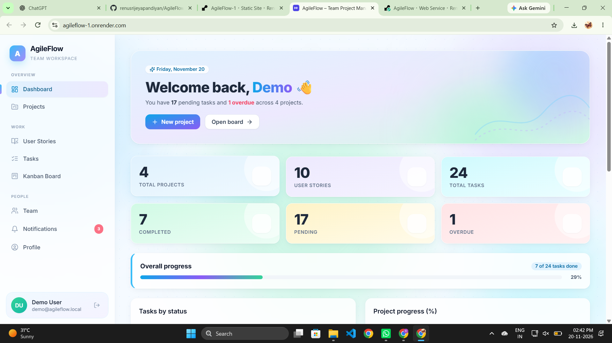
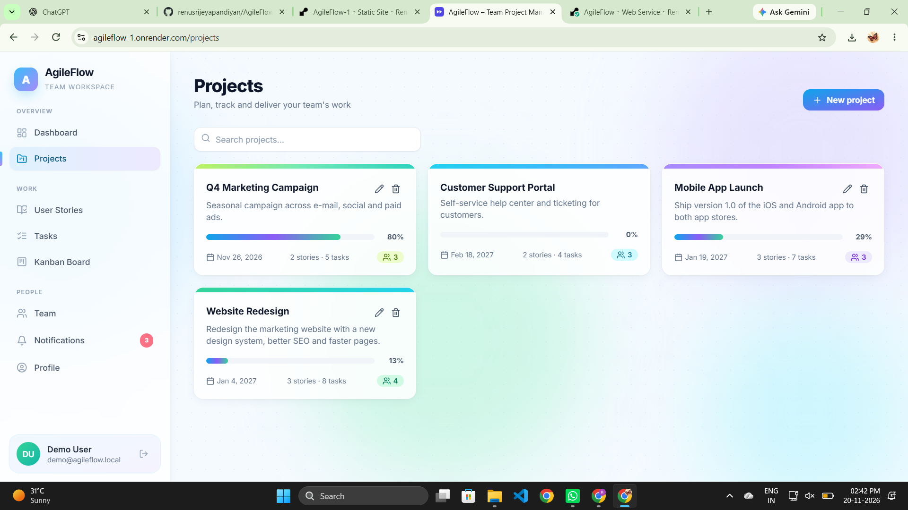
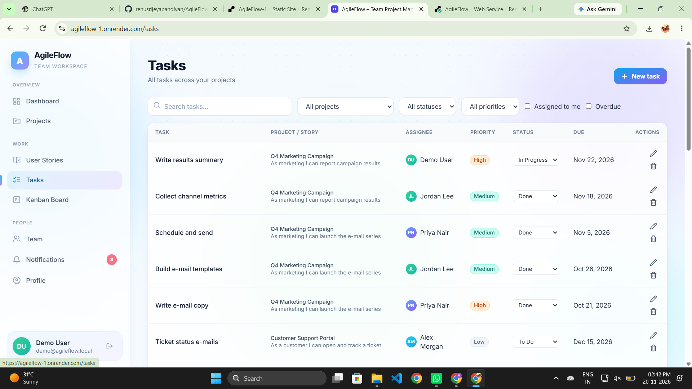

# 🚀 AgileFlow – Team Project Management System

<p align="center">
  <strong>A modern, full-stack Agile project management platform for small teams.</strong>
</p>

<p align="center">
  <a href="https://agileflow-1.onrender.com">🌐 Live Demo</a>
  &nbsp; • &nbsp;
  <a href="#-features">Features</a>
  &nbsp; • &nbsp;
  <a href="#-installation-and-setup">Installation</a>
  &nbsp; • &nbsp;
  <a href="#-screenshots">Screenshots</a>
</p>

---

## 🌐 Live Application

**Try AgileFlow here:**

🔗 https://agileflow-1.onrender.com

AgileFlow is a Jira/Linear-inspired project management application designed to help small teams organize projects, manage user stories, track tasks, collaborate with team members, and monitor project progress through an interactive dashboard.

## 📸 Screenshots

### 1. Dashboard

Get an overview of projects, tasks, overdue items, completion rates, project progress, and recent activity.



### 2. Projects

Create and manage projects, track deadlines, monitor progress, and organize project members.



### 3. Task Management

Search, filter, assign, and track tasks based on project, priority, status, and deadlines.



### 4. Team Management

Manage team members, assign job titles, transfer leadership, and monitor individual workloads.


---

## ✨ Features

### 🔐 Authentication and Security
- User registration and login.
- JWT-based authentication.
- BCrypt password encryption.
- Protected frontend routes.
- Stateless backend security.
- Project-level authorization.

### 📊 Interactive Dashboard
- Total projects and tasks.
- Completed and overdue tasks.
- Overall progress percentage.
- Task status charts.
- Project-wise progress tracking.
- Recent activity history.

### 📁 Project Management
- Create, update, view, and delete projects.
- Set project start dates and deadlines.
- Add and manage project members.
- Track project progress.
- View story and task counts.

### 📝 User Story Management
- Create and manage user stories.
- Define priorities and statuses.
- Add acceptance criteria.
- Organize stories under projects.

### ✅ Task Management
- Create and assign tasks.
- Track task priorities and statuses.
- Set deadlines.
- Search and filter tasks.
- View assigned and overdue tasks.

### 📌 Kanban Board
- Four workflow stages:
  - To Do
  - In Progress
  - Testing
  - Done
- Native HTML5 drag-and-drop.
- Database-persisted task status changes.

### 👥 Team Management
- Team leader and member management.
- Add members through search or email.
- Assign job titles.
- Transfer team leadership.
- Leave a project.
- Remove project members.
- Individual workload tracking.

### 🔔 Notification System
- Upcoming deadline notifications.
- Overdue task notifications.
- Mark notifications as read.
- Scheduled background scanning.
- Asynchronous notification processing.
- Retry mechanism and duplicate prevention.

### 👤 User Profile
- View and manage profile information.
- Personalized project and task experience.

---

## 🛠️ Tech Stack

| Category | Technologies |
|---|---|
| Frontend | React 18, Vite |
| Styling | Tailwind CSS 3 |
| Routing | React Router 6 |
| API Communication | Axios |
| Icons | Lucide |
| Charts | Recharts |
| Backend | Java 17, Spring Boot 3.2 |
| Backend Security | Spring Security, JWT, BCrypt |
| Database | SQLite |
| ORM | Spring Data JPA, Hibernate |
| API Documentation | Swagger / OpenAPI |
| Testing | JUnit 5, Mockito |
| Build Tool | Maven |

---

## 🏗️ System Architecture

AgileFlow follows a layered backend architecture with a React single-page frontend.

### Backend Architecture

```text
Frontend (React + Vite)
         |
         | REST API / Axios
         |
         v
Spring Boot Backend
         |
         v
Controller Layer
         |
         v
Service Layer
         |
         v
Repository Layer
         |
         v
SQLite Database
```

### Background Notification Workflow

```text
Scheduled Task Scanner
         |
         v
Identify Upcoming / Overdue Tasks
         |
         v
Create PENDING Notifications
         |
         v
Async Notification Processor
         |
         v
Deliver Notification
         |
         v
Update Processing Status
         |
         v
Retry Failed Notifications
```

**Architecture documentation:**
- [Architecture](docs/architecture.md)
- [Database Schema](docs/database-schema.md)
- [API Documentation](docs/api-documentation.md)
- [Design Decisions](docs/design-decisions.md)
- [Security](docs/security.md)
- [Async Workflow](docs/async-workflow.md)

---

## 🗄️ Database Schema

AgileFlow uses SQLite with Hibernate and Spring Data JPA.

Main database entities:

| Table | Purpose |
|---|---|
| users | Stores user information |
| projects | Stores project details |
| project_members | Manages project membership |
| user_stories | Stores project user stories |
| tasks | Stores task information |
| notifications | Stores deadline notifications |
| activity_logs | Tracks project activities |

### Entity Relationships

```text
User
 |
 +---- Project
          |
          +---- Project Members
          |
          +---- User Stories
                    |
                    +---- Tasks
                              |
                              +---- Notifications
```

For the complete schema, see [Database Schema](docs/database-schema.md).

---

## ⚙️ Installation and Setup

### Prerequisites

Install the following software:

- JDK 17 or later
- Apache Maven 3.9+
- Node.js 18+
- npm

For Windows PowerShell:

```powershell
winget install EclipseAdoptium.Temurin.17.JDK
winget install Apache.Maven
winget install OpenJS.NodeJS.LTS
```

Restart PowerShell after installation.

### 1. Clone the Repository

```bash
git clone <YOUR_GITHUB_REPOSITORY_URL>
cd AgileFlow
```

### 2. Start the Backend

Open Terminal 1:

```powershell
cd backend
mvn clean verify
mvn spring-boot:run
```

Backend runs at:

`http://localhost:8080`

**Important:** Run `mvn clean verify` first to compile the backend and execute unit tests.

### 3. Start the Frontend

Open Terminal 2:

```powershell
cd frontend
npm install
npm run dev
```

Frontend runs at:

`http://localhost:5173`

### 4. Open the Application

Visit:

`http://localhost:5173`

---

## 👤 Demo Account

Use the following credentials to explore AgileFlow.

| Field | Value |
|---|---|
| Email | demo@agileflow.local |
| Password | Demo@1234 |

Additional demo accounts:

- alex@agileflow.local
- sam@agileflow.local
- priya@agileflow.local
- jordan@agileflow.local

All accounts use the same demo password: `Demo@1234`.

### Sample Data

On the first startup, AgileFlow creates four sample projects:

1. Website Redesign
2. Mobile App Launch
3. Customer Support Portal
4. Q4 Marketing Campaign

Sample data includes:
- 10 user stories.
- 24 tasks across different workflow statuses.
- Overdue and upcoming tasks.
- Sample team members.
- Activity history.

The demo user has member-level permissions in Customer Support Portal, allowing comparison between project owner and member permissions.

Demo data is seeded only when the database is empty.

To reload demo data, stop the backend and delete:

`backend/agileflow.db`

Then restart the application. This permanently erases the existing database contents.

To disable demo data seeding:

```powershell
$env:SEED_DEMO="false"
```

---

## 🔧 Environment Variables

| Variable | Default | Description |
|---|---|---|
| JWT_SECRET | Auto-generated | JWT signing key (minimum 32 characters) |
| JWT_EXPIRATION_MS | 86400000 | JWT token expiration |
| DB_PATH | agileflow.db | SQLite database path |
| PORT | 8080 | Backend server port |
| CORS_ALLOWED_ORIGINS | localhost:5173 | Allowed frontend origins |
| SEED_DEMO | true | Enable demo data |
| DEMO_PASSWORD | Demo@1234 | Demo account password |
| NOTIFY_SCAN_INTERVAL_MS | 60000 | Notification scanning interval |
| NOTIFY_UPCOMING_DAYS | 2 | Upcoming deadline window |
| NOTIFY_MAX_RETRIES | 3 | Maximum retry attempts |
| NOTIFY_RETRY_BACKOFF_SECONDS | 30 | Retry backoff duration |
| VITE_API_URL | localhost:8080/api | Frontend API base URL |

Example:

```powershell
$env:JWT_SECRET="replace-with-a-long-random-string-32+chars"
mvn spring-boot:run
```

Refer to `frontend/.env.example` for frontend configuration.

---

## 📚 API Documentation

AgileFlow provides REST APIs for authentication, projects, user stories, tasks, teams, dashboards, and notifications.

### Swagger UI

Once the backend is running, open:

`http://localhost:8080/swagger-ui.html`

OpenAPI JSON:

`http://localhost:8080/v3/api-docs`

Use the **Authorize** option in Swagger UI with the JWT token returned by the login endpoint.

### Quick API Smoke Test

```powershell
$r = Invoke-RestMethod -Method Post `
  http://localhost:8080/api/auth/login `
  -ContentType application/json `
  -Body '{"email":"demo@agileflow.local","password":"Demo@1234"}'

$h = @{ Authorization = "Bearer $($r.token)" }

Invoke-RestMethod http://localhost:8080/api/dashboard/summary -Headers $h

Invoke-RestMethod http://localhost:8080/api/notifications -Headers $h
```

---

## 🧪 Testing

### Backend Tests

```bash
cd backend
mvn test
```

Unit tests cover:

- User registration and login.
- BCrypt password encryption.
- JWT generation and validation.
- JWT tampering and expiration.
- Deadline notification creation.
- Notification duplicate prevention.
- Asynchronous retry and failure handling.
- Task authorization and validation.

**Testing framework:** JUnit 5 + Mockito.

### Frontend Build

```bash
cd frontend
npm run build
```

The frontend build was successfully verified.

**Backend verification:** The backend source was written, but the initial generation environment could not compile it because Maven Central was inaccessible. Run `mvn clean verify` locally and resolve any reported issues before production use.

---

## 🚀 Deployment

AgileFlow is deployed using Render.

**Live application:**

https://agileflow-1.onrender.com

Deployment configuration includes:

- Backend Docker web service.
- Frontend static site.
- Backend Dockerfile.
- Render configuration (`render.yaml`).

See [Deployment Guide](docs/deployment.md).

**Free-tier limitations:**
- Backend may sleep when inactive.
- SQLite data can reset after redeployment.

---

## 🔒 Security Considerations

AgileFlow implements:

- BCrypt password hashing.
- JWT-based authentication.
- Environment-based JWT secret configuration.
- Project-level authorization.
- DTO validation.
- Centralized exception handling.
- Explicit CORS configuration.
- Generic login error messages.

Known limitations:

- JWT stored in browser localStorage.
- No rate limiting.
- Swagger UI is publicly accessible.

See [Security Documentation](docs/security.md).

---

## 💡 Design Decisions and Trade-offs

Important implementation decisions:

- SQLite for lightweight database management.
- Single pooled database connection.
- Protected deletes using HTTP 409 instead of cascading deletes.
- Database-backed notification queue.
- Native HTML5 drag-and-drop for Kanban.
- Layered backend architecture for maintainability.
- Asynchronous notification processing with retries.

More details: [Design Decisions](docs/design-decisions.md).

---

## 🔮 Future Enhancements

- Flyway database migrations.
- Refresh tokens and HttpOnly cookies.
- API rate limiting.
- Email and Slack notifications.
- Sprint management and burndown charts.
- Task comments and attachments.
- Advanced role-based permissions.
- WebSocket-based live Kanban updates.
- Integration testing with Testcontainers.
- Docker Compose support.
- Frontend code splitting and performance optimization.

---

## 🤖 AI Tools Usage Disclosure

This project was developed with assistance from **Claude (Anthropic)** acting as a coding agent.

All generated code should be reviewed, compiled, tested, and validated before production use.

---

## 👩‍💻 Author

**Renu Sri**

- GitHub: [renusrijeyapandiyan](https://github.com/renusrijeyapandiyan)
- LinkedIn: [Renu Sri](https://www.linkedin.com/in/renu-sri-j-b62895346/)
- Portfolio: [Personal Portfolio](https://renusrijeyapandiyan.github.io/Portfolio)

---

<p align="center">
  ⭐ If you find AgileFlow useful, consider giving this repository a star!
</p>

<p align="center">
  Built to make team collaboration and project tracking simpler.
</p>
