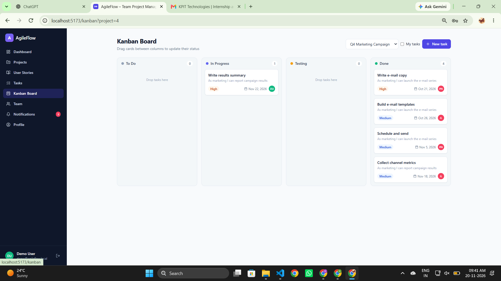
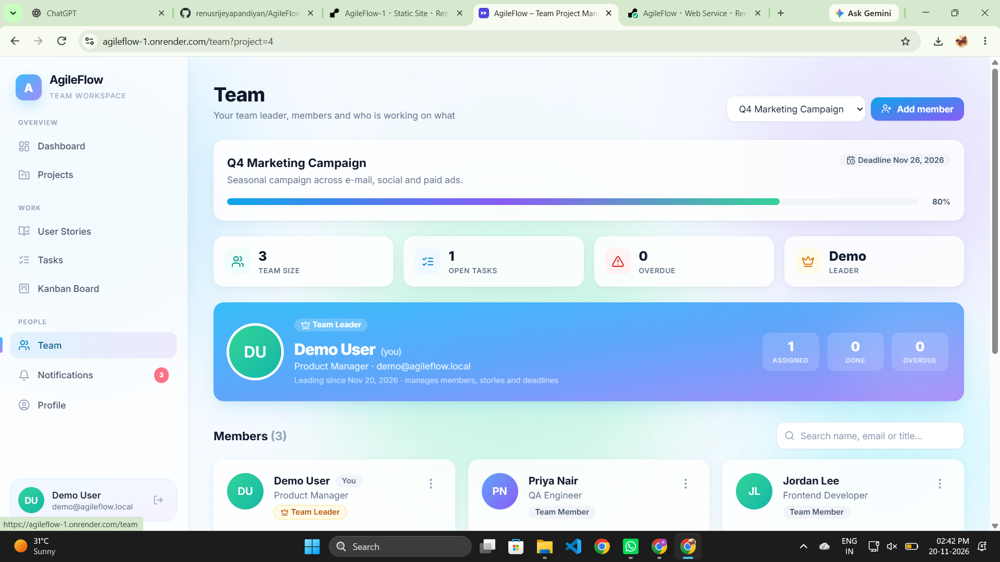

# AgileFlow – Team Project Management System

A full-stack agile project management tool (Jira/Linear-style): projects → user stories → tasks, a drag-and-drop Kanban board,
team management, a dashboard with charts, and a background workflow that generates deadline notifications.

> **Verification status:** the frontend was built (`npm run build`) successfully. The backend was written but **could not be compiled or
> run in the environment that generated it** (no Maven Central access). Run `mvn clean verify` first and fix any compile issue it reports (see *Troubleshooting*).

## Features
Auth (register/login/logout, BCrypt, JWT, protected routes) · Dashboard (totals, overdue, progress %, charts, recent activity) ·
Projects CRUD with dates & members · User stories CRUD (priority/status/acceptance criteria) · Tasks CRUD + assignment ·
Kanban (To Do / In Progress / Testing / Done, persisted) · Team leader & member management (add by search or email, job titles, transfer leadership, leave project, per-member workload) · Notification center (upcoming/overdue, mark read) ·
Profile · Redesigned gradient UI · Swagger UI · Scheduled + async deadline workflow with retries and de-duplication · Unit tests (JUnit 5 + Mockito).

📖 **New to the app? Read the [User Manual](docs/USER_MANUAL.md).**

## Tech stack
React 18 + Vite, Tailwind CSS 3, React Router 6, Axios, Lucide, Recharts · Java 17, Spring Boot 3.2 (Web, Data JPA/Hibernate, Security, Validation),
JWT (jjwt), SQLite (`sqlite-jdbc` + Hibernate community dialect), springdoc-openapi, Maven.

## Architecture
Layered backend (`controller → service → repository`), DTOs, centralized exception handling, stateless JWT security; SPA frontend talking to the REST API.
Details: [docs/architecture.md](docs/architecture.md) · [database-schema](docs/database-schema.md) · [api-documentation](docs/api-documentation.md) ·
[design-decisions](docs/design-decisions.md) · [security](docs/security.md) · [async-workflow](docs/async-workflow.md).

## Database schema (summary)
`users`, `projects`, `project_members`, `user_stories`, `tasks`, `notifications`, `activity_logs` with FKs, unique constraints and indexes.
Project 1─* UserStory 1─* Task. Full detail in [docs/database-schema.md](docs/database-schema.md).

## Prerequisites (Windows)
* JDK 17+ (`winget install EclipseAdoptium.Temurin.17.JDK`)
* Apache Maven 3.9+ (`winget install Apache.Maven`) — reopen PowerShell afterwards
* Node.js 18+ (`winget install OpenJS.NodeJS.LTS`)

## Run it (PowerShell)
**Terminal 1 – backend** (http://localhost:8080)
```powershell
cd AgileFlow\backend
mvn clean verify          # compiles + runs unit tests
mvn spring-boot:run
```
**Terminal 2 – frontend** (http://localhost:5173)
```powershell
cd AgileFlow\frontend
npm install
npm run dev
```
Open http://localhost:5173 and sign in with the demo account **demo@agileflow.local / Demo@1234**
(also `alex@`, `sam@`, `priya@` and `jordan@agileflow.local`, same password).
On first start the app seeds **4 sample projects** (Website Redesign, Mobile App Launch, Customer Support Portal, Q4 Marketing Campaign) with 10 user stories, 24 tasks across all statuses, overdue and due-soon tasks (so notifications appear), and activity history. In *Customer Support Portal* the demo user is only a **member**, so you can compare owner vs member permissions.
Seed data is created only when the database is empty. To reload it, stop the backend, delete `backend\agileflow.db`, and start again (**this erases all data**). Disable seeding with `$env:SEED_DEMO="false"`.

The SQLite file `backend/agileflow.db` is created on first start and persists across restarts.

## Environment variables
| Variable | Default | Purpose |
|---|---|---|
| `JWT_SECRET` | auto-generated, stored in `backend/.agileflow-jwt-secret` | HMAC key, ≥ 32 chars. **Set it in production** |
| `JWT_EXPIRATION_MS` | 86400000 | Token lifetime |
| `DB_PATH` | `agileflow.db` | SQLite file path |
| `PORT` | 8080 | Backend port |
| `CORS_ALLOWED_ORIGINS` | `http://localhost:5173,http://127.0.0.1:5173` | Comma-separated origins |
| `SEED_DEMO` / `DEMO_PASSWORD` | `true` / `Demo@1234` | Demo data |
| `NOTIFY_SCAN_INTERVAL_MS`, `NOTIFY_UPCOMING_DAYS`, `NOTIFY_MAX_RETRIES`, `NOTIFY_RETRY_BACKOFF_SECONDS` | 60000, 2, 3, 30 | Background workflow |
| `VITE_API_URL` (frontend, see `frontend/.env.example`) | `http://localhost:8080/api` | API base URL |

Example: `$env:JWT_SECRET="replace-with-a-long-random-string-32+chars"; mvn spring-boot:run`

## API documentation
Swagger UI: http://localhost:8080/swagger-ui.html (use *Authorize* with the token returned by `/api/auth/login`). OpenAPI JSON: `/v3/api-docs`.

Quick smoke test:
```powershell
$r = Invoke-RestMethod -Method Post http://localhost:8080/api/auth/login -ContentType application/json -Body '{"email":"demo@agileflow.local","password":"Demo@1234"}'
$h = @{ Authorization = "Bearer $($r.token)" }
Invoke-RestMethod http://localhost:8080/api/dashboard/summary -Headers $h
Invoke-RestMethod http://localhost:8080/api/notifications -Headers $h     # appears ~10 s after startup
```

## Tests
```powershell
cd backend ; mvn test
```
Covers registration/login/BCrypt, JWT round-trip/tampering/expiry, deadline-notification creation and de-duplication, async retry → FAILED logic,
and task authorization/validation rules (Mockito). Frontend: `cd frontend ; npm run build`.

## Screenshots
**Dashboard** – totals, overall progress, tasks by status, per-project progress and recent activity


**Kanban board** – drag cards between To Do / In Progress / Testing / Done (saved to the database)


**Projects** – progress, deadline, story/task counts and team size per project, with search


**Tasks** – searchable table with project, status and priority filters, plus "Assigned to me" and "Overdue"


**Team** – team leader spotlight, member cards with job titles and workload bars, add / remove / make leader


## Design decisions & trade-offs
See [docs/design-decisions.md](docs/design-decisions.md). Highlights: SQLite with a single pooled connection; protected deletes (409) rather than cascading deletes;
durable DB-backed notification queue; native HTML5 drag-and-drop.

## Security considerations
BCrypt, JWT with env-provided secret, per-project authorization on every endpoint, validated DTOs, explicit CORS, generic login errors.
Known limitations (localStorage token, no rate limiting, public Swagger) are listed in [docs/security.md](docs/security.md).

## Background workflow
`@Scheduled` job scans open tasks → creates `PENDING` notifications (unique dedupe key) → `@Async` processor delivers them, recording `status`, `retry_count`, `last_error`; failures retry with backoff up to a limit. See [docs/async-workflow.md](docs/async-workflow.md).

## Deployment (Render)
See [docs/deployment.md](docs/deployment.md) – a Docker web service for the API plus a static site for the frontend (`backend/Dockerfile` and `render.yaml` are included). Free tier: the API sleeps when idle and SQLite data resets on redeploy.

## Troubleshooting
* `Port 8080 in use` → `$env:PORT=8081` (and set `VITE_API_URL` accordingly).
* `WeakKeyException` → your `JWT_SECRET` is shorter than 32 characters.
* `database is locked` → run a single backend instance per DB file.
* Compile errors on first build → please report the exact message; the backend has not been compiled by its author's tooling.

## AI tools usage disclosure
This project was generated with the assistance of Claude (Anthropic) acting as a coding agent. All code should be reviewed, built and tested by you before production use.

## Future improvements
Flyway migrations · refresh tokens/HttpOnly cookies · rate limiting · e-mail/Slack delivery in `NotificationDeliverer` · sprints & burndown charts ·
comments/attachments · role-based permissions · WebSocket live board updates · integration tests with Testcontainers/in-memory SQLite · Docker Compose · code-splitting the frontend bundle.
